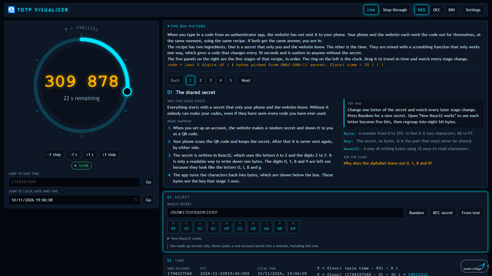

# TOTP Visualizer

Version 0.1.1

TOTP Visualizer is a browser-based teaching tool for showing how Time-based One-Time Passwords work. It is designed for students and teachers in further education who want to see the real steps behind authenticator apps, from the shared secret to the final six-digit code.

The app runs entirely in the browser, so no backend is required. It decodes a Base32 secret, converts the clock into a counter, performs an HMAC-SHA-1 step, truncates the digest, and shows the final code in context. Nothing is faked. The codes match a real authenticator app and the published RFC test vectors.

## Screenshot



## Contents

- [What is new in 0.1.1](#what-is-new-in-011)
- [Quick start](#quick-start)
- [Finding your way around the app](#finding-your-way-around-the-app)
- [How the algorithm works](#how-the-algorithm-works)
- [Teaching with the app](#teaching-with-the-app)
- [Deployment notes](#deployment-notes)
- [Privacy](#privacy)
- [Licence](#licence)

## What is new in 0.1.1

### Teaching

- The **teaching card** is now always on screen, under the header and to the right of the clock ring. The five pipeline stages sit below it.
- The card has a "big picture" section that explains the whole process in plain language, with the recipe on one line.
- Each stage now has five parts: why the stage exists, what happens (numbered), something to try, key terms, and a question for the class.
- Stage buttons (1 to 5, Back, Next) work in both Live and Step-through modes. The stage you pick is highlighted in the pipeline. In Step-through mode the other stages dim and the arrow keys move between stages.
- This README now includes a lesson plan, activities with answers and common misconceptions, for teachers who are new to the topic.

### Interface

- Clicking anywhere outside the settings drawer closes it.
- The favicon now appears in the header.
- The Exeter College badge (`src/components/CMFloatAd.jsx`) floats at the bottom right of the page.

### Fixes

- Typing a huge Unix time no longer crashes the app. Scrubbing now stops at the last date a browser can show.
- The `SCRUBBED +hh:mm:ss` chip stays accurate while the clock is scrubbed.
- Clicking the view you are already in (Live or Step-through) no longer resets the clock or the stage.
- The settings drawer now takes focus when it opens and hands it back when it closes.
- Screen readers no longer announce every code while you drag the ring.
- "N of 20 bytes changed" no longer compares digests made from different secrets.
- The verification window shows a message instead of an empty box when the secret is invalid.
- The QR panel shows the default issuer and account as placeholders.

### Project

- Added `src/state/reducer.test.js`. There are now 40 tests.
- `npm run lint` and `npm run doctor` are documented below.

## Quick start

```powershell
npm install
npm run dev      # Vite dev server on http://localhost:5173
npm test         # Vitest: library, state and component tests
npm run lint     # oxlint
npm run doctor   # react-doctor review of the React code
npm run build    # static site in dist/
```

## Finding your way around the app

| Area | What it does |
| --- | --- |
| **Clock ring** (left) | One full turn is one period (30 seconds by default). It runs live. Drag it, use the arrow keys, or use the buttons underneath to move through time. The big number in the middle is the current code. |
| **Teaching card** (top right) | The big picture, then one stage at a time with an explanation, a task and a question. |
| **Stages 01 to 05** (right) | Secret, Time, HMAC-SHA-1, Truncate, Code. Each one shows the real values for the moment on the ring. |
| **Verification window** (bottom) | The codes for the steps either side of now, plus a box to check a code the way a server would. |
| **Live / Step-through** (header) | Step-through freezes the clock so the numbers stay still while you talk. Exit to live returns to real time. |
| **HEX / DEC / BIN** (header) | Shows every byte in hex, decimal or binary. |
| **Settings** (header) | Opens a drawer with digits, period and T0, the RFC test vectors, the QR code and a share link. Click outside it or press Escape to close it. |

Two chips on the ring matter for teaching. **LIVE** means the ring follows the real clock. **SCRUBBED** means you have moved it, and it shows how far you are from real time. A phone will only match the app when the chip says LIVE.

## How the algorithm works

The app follows the standard TOTP algorithm described in RFC 4226 and RFC 6238:

1. Decode the Base32 secret into bytes.
2. Convert Unix time into a counter using the configured period and T0.
3. Build an 8-byte big-endian counter value.
4. Compute HMAC-SHA-1 over the key and counter.
5. Use the low nibble of the final byte as the offset.
6. Take four bytes from that offset and mask the top bit.
7. Convert that integer to a code string with a modulo of 10^digits.

Useful references:
- RFC 4226: <https://www.rfc-editor.org/rfc/rfc4226>
- RFC 6238: <https://www.rfc-editor.org/rfc/rfc6238>
- RFC 4648: <https://www.rfc-editor.org/rfc/rfc4648>

## Teaching with the app

This section is for teachers who have not taught this topic before. You do not need to know how HMAC works inside. The app does that part. What you need is the story, a few good questions and a sense of where students get stuck.

### The story in one minute

Read this aloud, or put it on a slide.

> When you type a code from your phone into a website, nothing was sent from the website to your phone. Both of them worked the code out for themselves. They started with a secret that only they know and the current time. They mixed those two things in a way that cannot be reversed, and kept the last six digits. Because they used the same secret and the same clock, they got the same answer.

The secret is shared once, when you scan the QR code. After that it is never sent again. Codes are safe to show because nobody can work backwards from a code to the secret.

### What students need to know first

- What a byte is, and that hex is a shorter way to write bytes. The HEX, DEC and BIN buttons help here.
- Roughly what a hash function does: it turns any input into a fixed-size scramble. A quick reminder is enough.
- What the remainder after division means. The card explains "mod" with 17 mod 5 = 2.

If students have not met these, spend five minutes on them first. They are not the point of the lesson.

### Key words

| Word | Plain meaning |
| --- | --- |
| TOTP | Time-based One-Time Password. A code that is only good for a short time. |
| Secret / key | The value that only your phone and the website know. |
| Base32 | A way to write bytes using A to Z and 2 to 7, so they are easy to read and type. |
| Unix time | Seconds since 1 January 1970, UTC. |
| Period (X) | How long each code lasts. Usually 30 seconds. |
| Counter (T) | The number of whole periods since T0. It goes up by one every period. |
| T0 | Where counting starts. Usually 0, which is 1 January 1970. |
| HMAC-SHA-1 | A standard way to mix a key and a message into 20 bytes that cannot be reversed. |
| Digest | The 20 bytes that HMAC gives out. |
| Offset | A number from 0 to 15 that says where to start reading in the digest. |
| Nibble | Half a byte, four bits. |
| Mask | Forcing some bits to 0. Here it clears the top bit so the number is positive. |
| Verification window | The few steps either side of now that a server will accept. |

### Suggested 60-minute lesson

You will need a projector, the app running (either your deployed site or `npm run dev`), and ideally a phone with an authenticator app for the last task. Use a made-up secret only. Never use a real account.

| Time | What happens | In the app |
| --- | --- | --- |
| 0 to 5 | **Starter.** Ask: "How does a website know the code on your phone is right, if it never sent it to you?" Take three guesses. Do not give the answer yet. | Show the ring running live. |
| 5 to 10 | **The story.** Read the one-minute story above. | Point at the big picture on the teaching card. |
| 10 to 40 | **Walk through the five stages.** About five minutes each. For each one, read "Why this stage exists", let students predict what will happen, press Next, then do the "Try this" task together. | Switch to **Step-through** so the numbers freeze. Use the arrow keys to move between stages. |
| 40 to 50 | **Scrub through time.** Return to Live and let students drag the ring. They should see the code change every time the ring crosses 12 o'clock. | Pick the **Live** view, then drag the ring and use the +1 step button. |
| 50 to 55 | **Phone check** (optional). Scan the QR code and compare. | Settings, QR code panel. |
| 55 to 60 | **Plenary.** Ask the exit questions at the end of this section. | Leave the app on the verification window. |

#### A good order for the five stages

1. **Secret.** Change one letter and watch every later stage change. Open "How Base32 works" and let one student read out the five-bit groups.
2. **Time.** Show the sum with real numbers. Ask students to say the Unix time out loud as it ticks. Point out that most of the eight counter bytes are zero.
3. **HMAC.** Press +1 step and read out "N of 20 bytes changed". It is nearly all of them. That is the whole point: a tiny change in the input scrambles the output completely.
4. **Truncate.** Ask students to find byte 19, read its last hex digit, and predict where the amber bracket will go before you move the clock.
5. **Code.** Show that "mod 1,000,000" just means "keep the last six digits". Then show a code with a leading zero.

### Activities

Each one has a clear task and an answer, so you can run it without knowing the topic deeply.

#### Activity 1: Predict the offset (stage 4, 5 minutes)

- Task: In pairs, look at byte 19 of the digest. Write down its last hex digit. Convert it to decimal. Predict where the bracket will start. Then press +1 step and check the next prediction.
- Answer: The last hex digit of byte 19, read as a number from 0 to 15, is the offset. The bracket starts at that byte. Example: if byte 19 is AB, the last digit is B, which is 11, so the bracket starts at byte 11.
- Check: In Settings, press Load on the 59 seconds test vector. Byte 19 is AB, the offset is 11, the four bytes are C1 39 7E EA and the code is 94287082 (the last six digits, 287082, are the classic six-digit answer).

#### Activity 2: Find the masked bit (stage 4, 5 minutes)

- Task: Step forward one step at a time until the red bit appears in "Mask the top bit". Record how many steps it took.
- Answer: It appears about every other step, because the top bit of a random byte is 1 half the time. When the first byte is below 80 hex, the app says "Top bit already 0, nothing to change".
- Why it matters: The mask makes sure the number is positive on every computer. It changes the first byte only when needed.

#### Activity 3: Find a code that starts with a zero (stage 5, 5 minutes)

- Task: Step through time until the code starts with 0. Look at stage 5. Why does it still show six digits?
- Answer: About one code in ten starts with 0, so it should happen within a few tries. The app shows "Result was 81804, padded to 081804". The code is text, not a number, so the zero must stay.
- Check: Open Settings, choose the RFC test vectors and press Load on 1111111109. The 8-digit code is 07081804.

#### Activity 4: Run the RFC test vectors (10 minutes)

- Task: Open Settings. Press **Run all** in the test vectors section. Press Load on any row and watch the pipeline.
- Answer: All six rows show a green tick. The last row is the year 2603, which proves the counter handles numbers bigger than 32 bits. Ask students why the authors of the RFC published the vectors. (So that anyone implementing TOTP can check they got it right.)

#### Activity 5: Clock drift and the verification window (10 minutes)

- Task: Set the server tolerance to ±0. Note the code at T − 1 (the card to the left of the middle one). Type it into "Verify a code". Then change the tolerance to ±1 and look again.
- Answer: With ±0 the app says the code matches T − 1 and would be rejected. With ±1 it says the code would still be accepted. Phones and servers have clocks that drift, and people type slowly, so servers accept a step or two either side.
- Discuss: What is the cost of making the window wider? (More codes are valid at once, so an attacker has more chances.) Why should a server also refuse a code it has already accepted? (So a stolen code cannot be replayed.)

#### Activity 6: Phone check (10 minutes, optional)

- Task: Open Settings and look at the QR code. Scan it with an authenticator app. Return the ring to Live. Compare the phone with the ring over three steps.
- Answer: They match every time. If they do not, check the chip says LIVE, not SCRUBBED. Also check Settings still has 6 digits, 30 seconds and T0 = 0. Most apps only support those values.
- Safety: Only use the made-up default secret or a random one from the Random button. Never scan a real account.

#### Activity 7: Break it on purpose (10 minutes)

- Task: Change the period to 15, then 60. Change T0 to a recent Unix time. Predict first, then check.
- Answer: With a shorter period the ring turns faster and T goes up faster. Changing T0 shifts the counter, so every code changes. Neither is wrong, but a phone will not match, because the QR code cannot carry T0 and most apps only use 30 seconds.

### Questions for discussion

Each of these is on the teaching card, with an answer here.

| Stage | Question | Suggested answer |
| --- | --- | --- |
| 1 | Why does the alphabet leave out 0, 1, 8 and 9? | They look like O, I, B and g. Leaving them out stops typing mistakes when someone copies a secret by hand. |
| 2 | What would go wrong if your phone's clock was five minutes fast? | Its counter would be about ten steps ahead of the server's. The codes would not match and the server would reject them. |
| 3 | Which bytes stayed the same when the counter ticked over? Is there a pattern? | Usually none, and now and then one by pure chance. There is no pattern. That unpredictability is the goal. |
| 4 | Why let the digest choose its own starting point? | It makes the four bytes harder to predict. An attacker cannot know which part of the digest is used without knowing the digest. |
| 5 | There are a million possible codes. Why is guessing still impractical? | The code is only valid for about 30 seconds, and servers lock accounts or slow down after a few wrong tries. |

### Exit questions

1. What two things go into HMAC?
2. Why do the phone and the website get the same code without talking?
3. What is the counter T, and how often does it change?
4. Why is a one-time code safe to show on screen, but the secret is not?
5. Name one thing that could make a phone and a server disagree.

Answers: 1. The secret key and the counter. 2. They share the secret and use the same clock, so they do the same maths. 3. The number of whole periods since T0. It goes up by one every period, which is 30 seconds by default. 4. The code only works for a short time and cannot be reversed into the secret. The secret can produce every future code. 5. A wrong clock, a different period, a different number of digits, a different T0, or a different secret.

### Common misconceptions

| Students often think | What is actually happening |
| --- | --- |
| "The website sends the code to my phone." | Nothing is sent. Both sides work it out. |
| "The code is random." | It looks random but is fully determined by the secret and the time. The same inputs always give the same code. |
| "The secret changes every 30 seconds." | The secret never changes. The counter changes. |
| "A longer period is always better." | It is easier to use, but each code is valid for longer, which gives an attacker more time. |
| "If someone sees my code they can get in forever." | The code is valid for about 30 seconds, and a good server will not accept the same code twice. |
| "If someone steals the secret nothing is lost." | They can make every future code. Treat the secret like a password. |
| "Leading zeros do not matter." | 081804 and 81804 are different codes. Codes are text, not numbers. |

### Differentiation

- **Support.** Keep the app on HEX and stay in Step-through mode. Do stages 1, 2 and 5 only and treat stages 3 and 4 as "the scrambling happens here". Use the "Try this" box as the only task.
- **Extension.** Switch to BIN and trace the offset and the mask by hand. Ask students to write the algorithm in a language they know, then use the RFC test vectors to check it. Discuss why SHA-1 is no longer recommended for new designs but is still used in TOTP.
- **Discussion.** Compare TOTP with codes sent by text message. What can an attacker do to one that they cannot do to the other?

### Assessment ideas

- Ask students to label the five stages on a blank diagram, and write one sentence for each.
- Give them one worked example (the RFC secret at counter 1) and ask them to find the offset, the four bytes and the code from the app.
- Ask for a short written answer: "Explain why a stolen code is much less dangerous than a stolen secret."
- Ask them to design a test plan for a TOTP implementation. A good answer uses the RFC test vectors.

### Safety and good practice

- Only use made-up secrets in class. The app warns about this, and the share link contains the secret in plain text.
- Do not let students scan a QR code for a real account into any website.
- The app stores nothing and sends nothing. Closing the tab discards everything.

## Deployment notes

The app is static. `npm run build` produces `dist/`. Upload its contents to the root of a subdomain on any Apache host.

- HTTPS is required. Web Crypto, which does the HMAC step, only runs on HTTPS or on `localhost`. On plain HTTP the app shows a message instead of the visualizer.
- `public/.htaccess` is copied into `dist/` by the build. It denies access to any `.config.json` (kept for consistency with the author's other projects, though this app has none) and sends unknown paths to `index.html`. Some upload tools skip dotfiles, so check it arrived.

```powershell
npm run build
Get-ChildItem dist -Force   # confirm .htaccess is present
```

## Privacy

Everything runs in the browser. Nothing is transmitted or stored. The secret only leaves the page if you choose **Copy link**, which puts it in the part of the address after `#`. Browsers never send that part to the server, but anyone you give the link to can read it, so only share made-up secrets.

## Licence

This software is released under the Creative Commons Attribution-NonCommercial-ShareAlike 4.0 International licence.

- **You may** copy and share the material, and adapt or build on it.
- **Attribution:** you must credit Simon Rundell, link to the licence, and say if you changed anything.
- **NonCommercial:** you may not use it for commercial purposes.
- **ShareAlike:** if you adapt it, you must release your version under the same licence.
- No extra legal or technical restrictions may be added.

Full licence: <https://creativecommons.org/licenses/by-nc-sa/4.0/>
